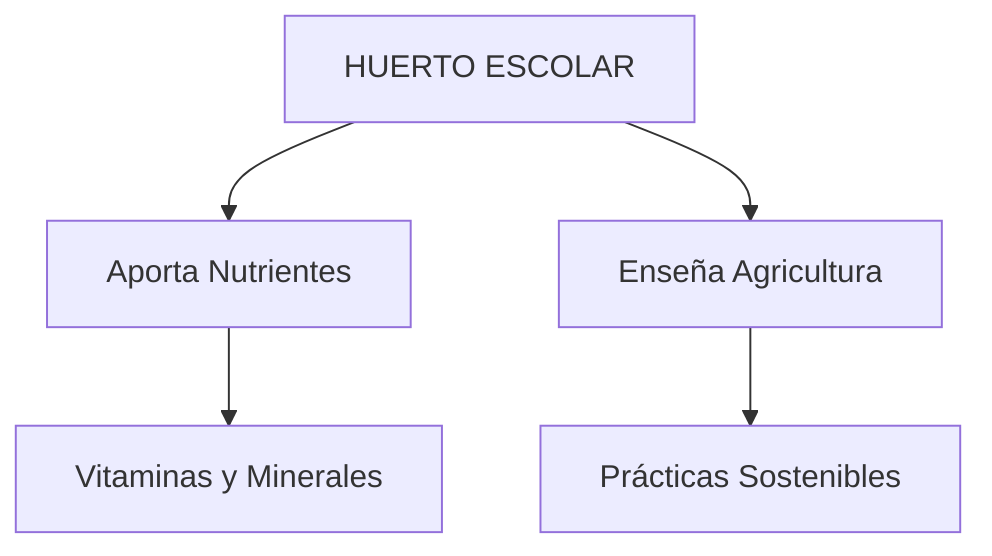

# SKILLS.md — Catálogo de Habilidades Operativas del Portal de Actividades (MEDUCA 2026)

> **Manual de Procedimientos, Habilidades Técnicas y Flujos de Trabajo (*Runbooks*) del Agente y del Docente.**  
> Este documento define las capacidades operativas, scripts, comandos y protocolos para el mantenimiento, actualización y extensión del **Portal Web de Actividades Curriculares — Tecnología (Agricultura)** en el **C.E.B.G. Cerro Tigre**.

---

## Índice de Habilidades

1. [SKILL 01: Sincronización Automática en Tiempo Real con la Libreta de Calificaciones](#skill-01-sincronización-automática-en-tiempo-real-con-la-libreta-de-calificaciones)
2. [SKILL 02: Sincronización Manual de Emergencia y Respaldo de Datos](#skill-02-sincronización-manual-de-emergencia-y-respaldo-de-datos)
3. [SKILL 03: Gestión y Estructuración Curricular de Actividades (3.º a 6.º Grado)](#skill-03-gestión-y-estructuración-curricular-de-actividades-3º-a-6º-grado)
4. [SKILL 04: Aplicación y Verificación de Rúbricas Oficiales MEDUCA](#skill-04-aplicación-y-verificación-de-rúbricas-oficiales-meduca)
5. [SKILL 05: Renderizado y Edición de Organizadores Gráficos (Mermaid.js Local)](#skill-05-renderizado-y-edición-de-organizadores-gráficos-mermaidjs-local)
6. [SKILL 06: Administración y Despliegue de Pruebas Evaluativas Digitales](#skill-06-administración-y-despliegue-de-pruebas-evaluativas-digitales)
7. [SKILL 07: Calibración y Generación de Informes Oficiales para Impresión / PDF](#skill-07-calibración-y-generación-de-informes-oficiales-para-impresión--pdf)
8. [SKILL 08: Verificación de Integridad y Autonomía Offline 100%](#skill-08-verificación-de-integridad-y-autonomía-offline-100)

---

## SKILL 01: Sincronización Automática en Tiempo Real con la Libreta de Calificaciones

### Propósito
Mantener el portal web permanentemente actualizado con las notas, actividades creadas o fechas programadas en el **Agente de Libreta de Calificaciones**, sin necesidad de intervención manual o reinicio de páginas.

### Archivos Involucrados
- [`sync_watcher.py`](file:///G:/Mi%20unidad/MEDUCA/AGRICULTURA/ACTIVIDADES/sync_watcher.py)
- [`js/data.js`](file:///G:/Mi%20unidad/MEDUCA/AGRICULTURA/ACTIVIDADES/js/data.js)
- [`js/app.js`](file:///G:/Mi%20unidad/MEDUCA/AGRICULTURA/ACTIVIDADES/js/app.js)
- `C:\Users\Alex\OneDrive\MEDUCA\AGENTES\AGENTE_LIBRETA_CALIFICACIONES\sync_actividades.py`
- `C:\Users\Alex\OneDrive\MEDUCA\AGENTES\AGENTE_LIBRETA_CALIFICACIONES\backups\*.json`

### Procedimiento de Operación
1. **Lanzamiento del Monitor en Segundo Plano:**
   Abrir una terminal de PowerShell en el directorio de trabajo y ejecutar:
   ```powershell
   python sync_watcher.py
   ```
2. **Mecanismo de Detección:**
   - Monitorea la carpeta `backups/` del Agente de Libreta cada 2 segundos.
   - Ante la detección de un archivo nuevo o con marca de tiempo modificada (`mtime`), ejecuta atómicamente la extracción mediante `sync_actividades.export_actividades_data()`.
   - Sobrescribe [`js/data.js`](file:///G:/Mi%20unidad/MEDUCA/AGRICULTURA/ACTIVIDADES/js/data.js) con formato UTF-8 limpio.
3. **Recepción en el Navegador:**
   - La aplicación detecta el cambio automáticamente por sondeo dinámico (`script.src = js/data.js?t=Date.now()`) o al recuperar el foco (`window.onfocus`).
   - Muestra una notificación flotante (*Toast*): `"¡Actividades actualizadas desde la libreta!"`.

---

## SKILL 02: Sincronización Manual de Emergencia y Respaldo de Datos

### Propósito
Actualizar la base de datos de actividades bajo demanda cuando el servicio en segundo plano no se encuentre en ejecución o cuando se requiera forzar una actualización puntual.

### Archivos Involucrados
- [`actualizar_datos.bat`](file:///G:/Mi%20unidad/MEDUCA/AGRICULTURA/ACTIVIDADES/actualizar_datos.bat)
- [`actualizar_datos.py`](file:///G:/Mi%20unidad/MEDUCA/AGRICULTURA/ACTIVIDADES/actualizar_datos.py)

### Procedimiento
1. **Ejecución Directa desde el Explorador de Windows:**
   - Hacer doble clic sobre [`actualizar_datos.bat`](file:///G:/Mi%20unidad/MEDUCA/AGRICULTURA/ACTIVIDADES/actualizar_datos.bat).
2. **Ejecución vía Terminal:**
   ```powershell
   python actualizar_datos.py
   ```
3. **Verificación de Salida:**
   - Comprobar que en consola aparezca:
     `[SYNC] Sincronización exitosa con la web de actividades: ...\js\data.js`
   - Validar que [`js/data.js`](file:///G:/Mi%20unidad/MEDUCA/AGRICULTURA/ACTIVIDADES/js/data.js) posea el timestamp correspondiente y la variable global `window.actividadesData`.

---

## SKILL 03: Gestión y Estructuración Curricular de Actividades (3.º a 6.º Grado)

### Propósito
Clasificar, ordenar y asociar pedagógicamente las actividades registradas en la libreta con las competencias oficiales de Tecnología (Agricultura) MEDUCA 2026.

### Reglas de Clasificación Didáctica
El motor clasifica automáticamente cada actividad según su denominación:

| Patrón en Nombre | Categoría Asignada | Descripción Curricular |
|:---|:---:|:---|
| `separador` | **Separador** | Apertura y rotulación temática del cuaderno. |
| `vocabulario`, `glosario`, `sopa` | **Vocabulario** | Definición e ilustración de términos agronómicos. |
| `charla`, `ornamentales` | **Charla** | Exposición oral, identificación botánica y cuidados. |
| `lección`, `conceptual`, `mental` | **Organizador** | Construcción de mapas conceptuales y esquemas mentales. |
| `campo`, `limpieza`, `huerto`, `era` | **Campo** | Labores prácticas en terreno escolar, aporque y siembra. |
| `prueba`, `quiz`, `evaluativa` | **Evaluación** | Comprobación sumativa de conocimientos adquiridos. |

### Contenidos Programáticos por Grado (Trimestre III)
- **3.° Grado:** El huerto escolar y la nutrición, germinación, hortalizas y herramientas básicas.
- **4.° Grado:** Materia orgánica, elaboración de abono Bocashi, coberturas vivas y leguminosas.
- **5.° Grado:** Conservación de suelo y agua, texturas, biofertilizante líquido (Biol) y curvas a nivel (Nivel "A").
- **6.° Grado:** Agroforestería, sistemas silvopastoriles, pH y enmiendas calcáreas, protección de microcuencas.

---

## SKILL 04: Aplicación y Verificación de Rúbricas Oficiales MEDUCA

### Propósito
Asegurar que todas las actividades cuenten con criterios de evaluación estandarizados, transparentes y alineados con la escala oficial de calificaciones (1.0 a 5.0).

### Rúbricas Integradas en el Sistema
1. **Rúbrica de Manualidades (Separador Trimestral - 20 pts / Nota 5.0):**
   - Destreza técnica (Recortar y pegar): 30% (6 pts)
   - Creatividad y composición temática: 25% (5 pts)
   - Limpieza y orden de presentación: 20% (4 pts)
   - Uso de materiales solicitados: 15% (3 pts)
   - Puntualidad en la entrega: 10% (2 pts)
2. **Rúbrica Oficial de Trabajo en Campo (Labores en Huerto - 100% / Nota 5.0):**
   - Uso de herramientas y seguridad (EPP): 25%
   - Ejecución técnica (Labor agronómica): 25%
   - Sostenibilidad y cuidado ecológico: 20%
   - Registro y diario de campo: 15%
   - Actitud y trabajo colaborativo: 15%

---

## SKILL 05: Renderizado y Edición de Organizadores Gráficos (Mermaid.js Local)

### Propósito
Modificar, actualizar y generar mapas conceptuales y esquemas mentales con sintaxis Mermaid interactiva sin conexión a internet.

### Archivos Involucrados
- [`js/mermaid.min.js`](file:///G:/Mi%20unidad/MEDUCA/AGRICULTURA/ACTIVIDADES/js/mermaid.min.js)
- [`js/app.js`](file:///G:/Mi%20unidad/MEDUCA/AGRICULTURA/ACTIVIDADES/js/app.js) (Sección `isLeccion`)
- Recursos individuales en [`recursos/`](file:///G:/Mi%20unidad/MEDUCA/AGRICULTURA/ACTIVIDADES/recursos)

### Sintaxis Estándar para Mapas Conceptuales


### Protocolo de Actualización
1. Editar la definición del diagrama en el bloque correspondiente dentro de [`js/app.js`](file:///G:/Mi%20unidad/MEDUCA/AGRICULTURA/ACTIVIDADES/js/app.js) o en su archivo espejo de [`recursos/`](file:///G:/Mi%20unidad/MEDUCA/AGRICULTURA/ACTIVIDADES/recursos).
2. Verificar que los identificadores de nodos y conectores no contengan caracteres especiales sin entrecomillar.
3. Llamar a `mermaid.run()` o `mermaid.init()` tras inyectar el HTML en el DOM.

---

## SKILL 06: Administración y Despliegue de Pruebas Evaluativas Digitales

### Propósito
Gestionar la plataforma interactiva de evaluaciones sumativas y formativas en [`pruebas/`](file:///G:/Mi%20unidad/MEDUCA/AGRICULTURA/ACTIVIDADES/pruebas) para los estudiantes y el docente.

### Estructura de la Evaluación Oficial (19 Puntos)
- **Parte A (5 pts):** Completar enunciados guiados con banco de palabras clave.
- **Parte B (5 pts):** Selección múltiple ilustrada con opciones analíticas.
- **Parte C (9 pts):** Análisis de casos técnicos, prácticas sostenibles y seguridad.

### Procedimiento para Estudiantes Ausentes o Nivelación
1. Proporcionar el enlace local o la URL del portal de pruebas al estudiante:
   - 3.º Grado: [`pruebas/tercer_grado.html`](file:///G:/Mi%20unidad/MEDUCA/AGRICULTURA/ACTIVIDADES/pruebas/tercer_grado.html)
   - 4.º Grado: [`pruebas/cuarto_grado.html`](file:///G:/Mi%20unidad/MEDUCA/AGRICULTURA/ACTIVIDADES/pruebas/cuarto_grado.html)
   - 5.º Grado: [`pruebas/quinto_grado.html`](file:///G:/Mi%20unidad/MEDUCA/AGRICULTURA/ACTIVIDADES/pruebas/quinto_grado.html)
   - 6.º Grado: [`pruebas/sexto_grado.html`](file:///G:/Mi%20unidad/MEDUCA/AGRICULTURA/ACTIVIDADES/pruebas/sexto_grado.html)
2. El estudiante selecciona su grupo y su nombre desde la nómina cargada en [`pruebas/data/estudiantes.json`](file:///G:/Mi%20unidad/MEDUCA/AGRICULTURA/ACTIVIDADES/pruebas/data/estudiantes.json).
3. Al finalizar, la nota se calcula automáticamente y queda disponible en el panel [`pruebas/docente.html`](file:///G:/Mi%20unidad/MEDUCA/AGRICULTURA/ACTIVIDADES/pruebas/docente.html).

---

## SKILL 07: Calibración y Generación de Informes Oficiales para Impresión / PDF

### Propósito
Emitir copias impresas o documentos PDF de la programación de actividades y rúbricas con membrete institucional del MEDUCA y líneas de validación.

### Reglas de Diseño de Impresión (`@media print`)
- Ocultar cabeceras fijas, botones de navegación, toggles y elementos decorativos con la clase `.no-print`.
- Forzar contraste y legibilidad con tipografía negra sobre fondo blanco puro.
- Incluir membrete institucional:
  - *Ministerio de Educación — República de Panamá*
  - *Centro Educativo Básico General Cerro Tigre*
  - *Tecnología (Agricultura) — Prof. Carlos Iván Pimentel Marín*
- Incorporar espacio inferior para firmas:
  - Docente de la Cátedra
  - Dirección / Subdirección Técnico-Docente

---

## SKILL 08: Verificación de Integridad y Autonomía Offline 100%

### Propósito
Garantizar que el portal funcione en computadoras de aula, portátiles de campo o dispositivos móviles sin acceso a internet.

### Lista de Chequeo Obligatoria (Checklist)
- [x] Librería Mermaid embebida localmente en [`js/mermaid.min.js`](file:///G:/Mi%20unidad/MEDUCA/AGRICULTURA/ACTIVIDADES/js/mermaid.min.js).
- [x] Estilos base e iconografía renderizada mediante caracteres Unicode y Tailwind pre-procesado.
- [x] Base de datos en archivo plano JavaScript autónomo ([`js/data.js`](file:///G:/Mi%20unidad/MEDUCA/AGRICULTURA/ACTIVIDADES/js/data.js)).
- [x] Lanzador por lotes ([`iniciar_web.bat`](file:///G:/Mi%20unidad/MEDUCA/AGRICULTURA/ACTIVIDADES/iniciar_web.bat)) operativo con rutas relativas.

---

*Manual de habilidades y procedimientos técnicos actualizado para el periodo lectivo 2026.*
